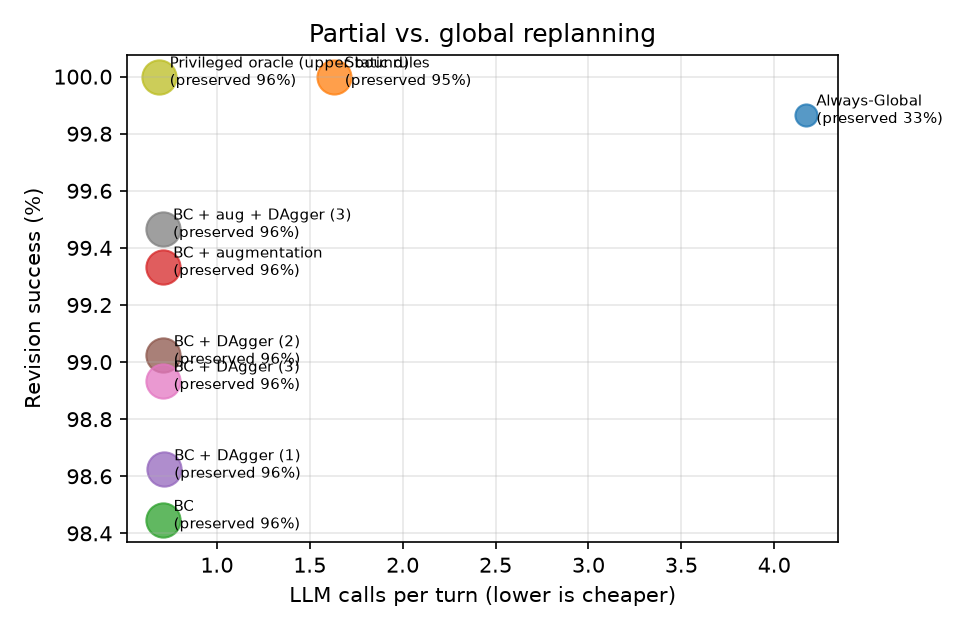
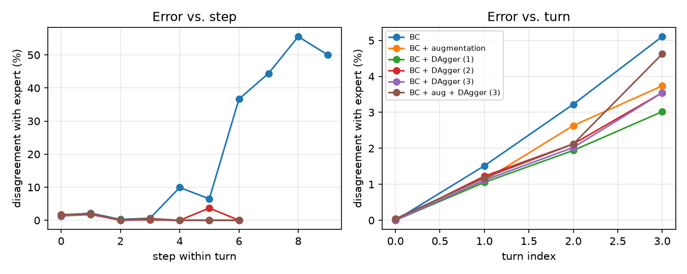
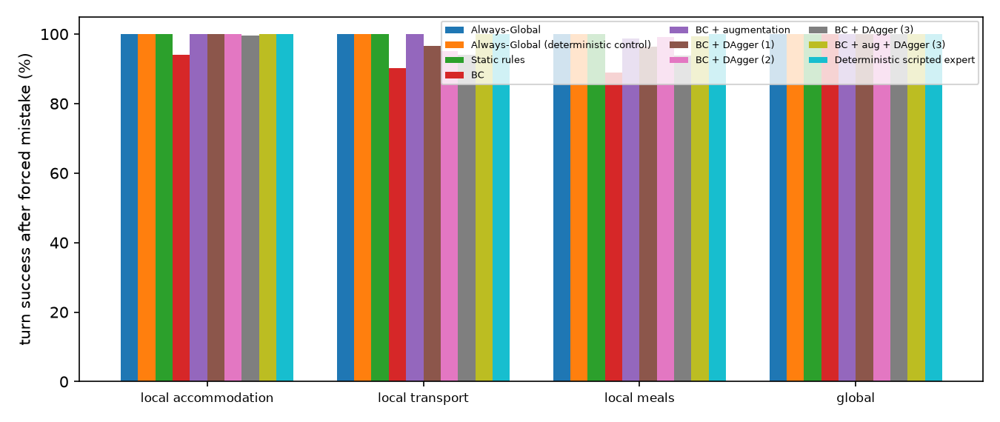

# Results (test split)

Config: `{'seeds': [0, 1, 2], 'split': 'test', 'llm': 'offline', 'limit': None}` · git `c8872ce`

Rates are percentages. Learned systems: mean ± std over training seeds. Token counts come from the simulated cost model (see README).

| System | Final pass | Revision success | New constr. sat. | Retention | Unaffected preserved | Unneeded global | LLM calls/turn | Tool calls/turn | Est. tokens/turn |
|---|---|---|---|---|---|---|---|---|---|
| Always-Global | 99.7 | 99.9 | 100.0 | 99.9 | 33.0 | 47.9 | 4.17 | 3.00 | 6,051 |
| Static rules | 100.0 | 100.0 | 100.0 | 100.0 | 95.1 | 2.9 | 1.63 | 1.16 | 2,471 |
| BC | 97.1 ± 0.3 | 98.4 ± 0.1 | 98.6 ± 0.3 | 99.9 ± 0.1 | 96.1 ± 0.0 | 0.0 | 0.71 ± 0.01 | 0.59 ± 0.00 | 1,088 |
| BC + augmentation | 99.0 ± 0.3 | 99.3 ± 0.2 | 99.5 ± 0.3 | 99.9 ± 0.1 | 96.1 ± 0.0 | 0.0 | 0.71 ± 0.00 | 0.60 ± 0.00 | 1,100 |
| BC + DAgger (1) | 97.5 ± 0.2 | 98.6 ± 0.1 | 98.8 ± 0.3 | 99.9 ± 0.1 | 96.1 ± 0.0 | 0.0 | 0.71 ± 0.01 | 0.59 ± 0.00 | 1,097 |
| BC + DAgger (2) | 98.4 ± 0.3 | 99.0 ± 0.2 | 99.4 ± 0.3 | 99.9 ± 0.1 | 96.1 ± 0.0 | 0.0 | 0.71 ± 0.01 | 0.59 ± 0.00 | 1,099 |
| BC + DAgger (3) | 98.2 ± 0.9 | 98.9 ± 0.5 | 99.2 ± 0.7 | 99.9 ± 0.0 | 96.1 ± 0.0 | 0.0 | 0.71 ± 0.00 | 0.59 ± 0.00 | 1,095 |
| BC + aug + DAgger (3) | 99.2 ± 0.6 | 99.5 ± 0.2 | 99.6 ± 0.3 | 99.9 ± 0.1 | 96.0 ± 0.0 | 0.0 | 0.71 ± 0.00 | 0.59 ± 0.00 | 1,096 |
| Privileged oracle (upper bound) | 100.0 | 100.0 | 100.0 | 100.0 | 96.0 | 0.0 | 0.69 | 0.58 | 1,066 |

## Clarification behaviour

| System | Recall on infeasible updates | Precision | Timeouts |
|---|---|---|---|
| Always-Global | 100.0 | 99.2 | 0.0 |
| Static rules | 100.0 | 100.0 | 0.0 |
| BC | 98.4 | 94.0 ± 1.7 | 0.5 ± 0.2 |
| BC + augmentation | 99.2 ± 0.6 | 98.7 ± 0.7 | 0.4 ± 0.1 |
| BC + DAgger (1) | 98.4 | 95.2 ± 1.5 | 0.5 ± 0.2 |
| BC + DAgger (2) | 98.4 | 97.2 ± 1.9 | 0.5 ± 0.2 |
| BC + DAgger (3) | 98.4 | 96.5 ± 3.3 | 0.4 ± 0.1 |
| BC + aug + DAgger (3) | 99.0 ± 0.4 | 98.7 ± 1.0 | 0.4 ± 0.1 |
| Privileged oracle (upper bound) | 100.0 | 100.0 | 0.0 |

## Recovery from a forced mistake (184 episodes whose first update needs a repair)

The listed action is forced as the first step of the turn; the coordinator then continues. Cell = turn success % (LLM calls).

| System | REPLAN_LOCAL_ACCOMMODATION | REPLAN_LOCAL_TRANSPORT | REPLAN_LOCAL_MEALS | REPLAN_GLOBAL |
|---|---|---|---|---|
| Always-Global | 100.0 (5.00) | 100.0 (5.00) | 100.0 (5.00) | 100.0 (4.00) |
| Static rules | 100.0 (2.22) | 100.0 (2.32) | 100.0 (3.47) | 100.0 (5.00) |
| BC | 86.2 (1.92) | 98.0 (2.09) | 100.0 (1.81) | 100.0 (4.00) |
| BC + augmentation | 100.0 (1.94) | 100.0 (2.03) | 100.0 (1.81) | 100.0 (4.00) |
| BC + DAgger (1) | 91.3 (2.04) | 97.6 (2.12) | 100.0 (1.81) | 100.0 (4.00) |
| BC + DAgger (2) | 96.7 (2.11) | 82.8 (2.30) | 78.4 (1.80) | 100.0 (4.00) |
| BC + DAgger (3) | 95.5 (2.08) | 90.6 (2.05) | 70.7 (1.80) | 100.0 (4.00) |
| BC + aug + DAgger (3) | 100.0 (1.94) | 100.0 (2.03) | 96.9 (1.81) | 100.0 (4.00) |
| Privileged oracle (upper bound) | 100.0 (1.94) | 100.0 (2.03) | 100.0 (1.81) | 100.0 (4.00) |

## By update type

Revision success % / unaffected preserved %. Learned systems: training seed 0.

| System | add | delete | replace | reprioritize |
|---|---|---|---|---|
| Always-Global | 100.0 / 35 | 98.4 / 25 | 100.0 / 29 | 100.0 / 27 |
| Static rules | 100.0 / 93 | 100.0 / 100 | 100.0 / 97 | 100.0 / 100 |
| BC | 98.3 / 94 | 100.0 / 100 | 97.7 / 100 | 97.4 / 100 |
| BC + augmentation | 99.4 / 94 | 100.0 / 100 | 98.5 / 100 | 97.4 / 100 |
| BC + DAgger (1) | 98.3 / 94 | 100.0 / 100 | 97.7 / 100 | 100.0 / 100 |
| BC + DAgger (2) | 99.0 / 94 | 100.0 / 100 | 98.5 / 100 | 100.0 / 100 |
| BC + DAgger (3) | 98.1 / 94 | 100.0 / 100 | 96.9 / 100 | 100.0 / 100 |
| BC + aug + DAgger (3) | 99.8 / 94 | 100.0 / 100 | 98.5 / 100 | 96.2 / 100 |
| Privileged oracle (upper bound) | 100.0 / 94 | 100.0 / 100 | 100.0 / 100 | 100.0 / 100 |

## By turn position (4th turn only exists in test)

Revision success % / unaffected preserved %. Learned systems: training seed 0.

| System | held-out (4th turn) | turn 1 | turn 2 | turn 3 |
|---|---|---|---|---|
| Always-Global | 98.8 / 31 | 100.0 / 35 | 100.0 / 32 | 100.0 / 31 |
| Static rules | 100.0 / 97 | 100.0 / 94 | 100.0 / 96 | 100.0 / 95 |
| BC | 91.9 / 99 | 100.0 / 94 | 99.5 / 97 | 96.7 / 98 |
| BC + augmentation | 96.5 / 98 | 100.0 / 94 | 100.0 / 97 | 97.4 / 98 |
| BC + DAgger (1) | 95.3 / 98 | 100.0 / 94 | 99.5 / 97 | 96.1 / 98 |
| BC + DAgger (2) | 96.5 / 98 | 100.0 / 94 | 100.0 / 97 | 97.4 / 97 |
| BC + DAgger (3) | 96.5 / 98 | 99.0 / 94 | 99.1 / 97 | 96.7 / 98 |
| BC + aug + DAgger (3) | 96.5 / 98 | 100.0 / 94 | 100.0 / 97 | 98.0 / 97 |
| Privileged oracle (upper bound) | 100.0 / 98 | 100.0 / 94 | 100.0 / 97 | 100.0 / 97 |

## Figures

