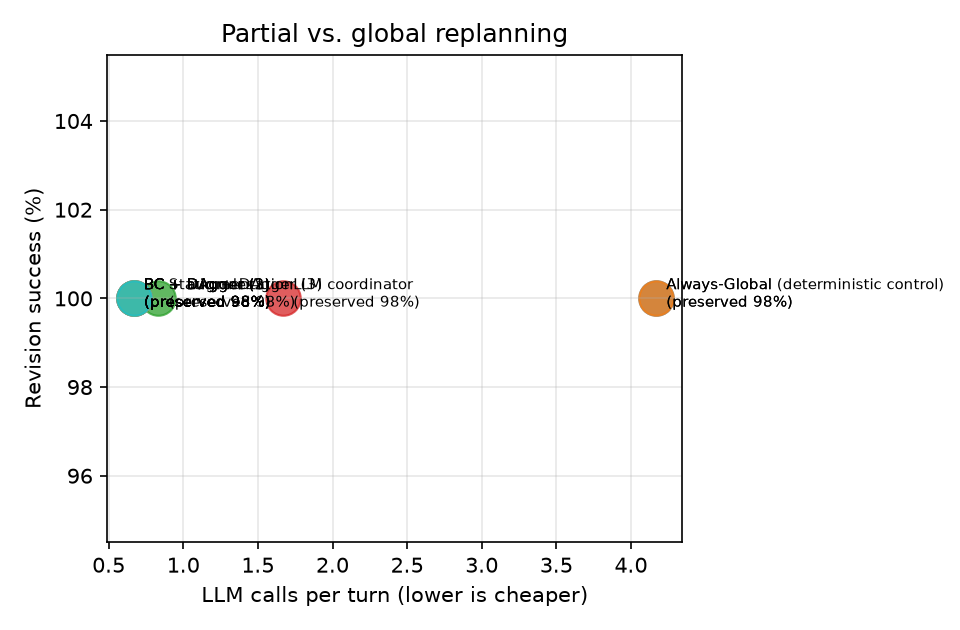
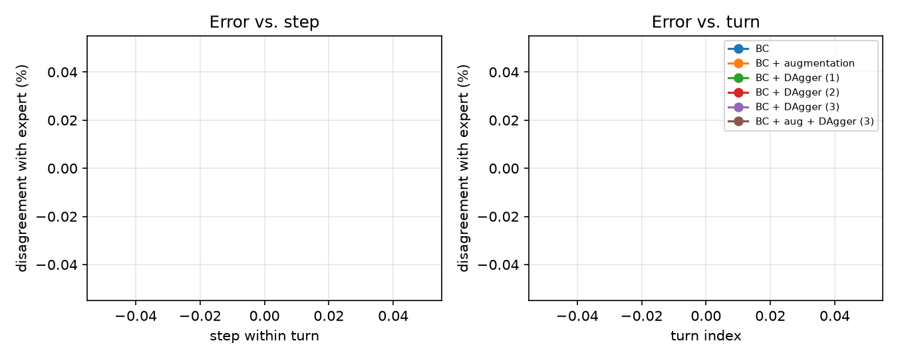

# Results (val split)

Config: `{'seeds': [0], 'split': 'val', 'limit': 2, 'skip_recovery': True, 'model_suffix': '', 'call_cap': None, 'llm': {'provider': 'fake', 'model': 'fake', 'endpoint': 'local://fake', 'temperature': 0.0}, 'models': 'd6245b50cd4c'}`

git `1aaeecd` (uncommitted changes) · fingerprints `{'source': '883e3d07447a', 'prompts': 'f9352f57f9ee', 'tasks': '3753a97fdb1e'}`

Rates are percentages. Learned systems: mean ± std over training seeds. LLM calls/tool calls/est. tokens come from the simulated cost model (see README); measured columns come from the live client.

| System | Final pass | Revision success | New constr. sat. | Retention | Legacy unaffected preserved | Slots edited | Unneeded global | LLM calls/turn | Tool calls/turn | Est. tokens/turn | Measured LLM requests/turn | Measured tokens/turn |
|---|---|---|---|---|---|---|---|---|---|---|---|---|
| Always-Global | 100.0 | 100.0 | 100.0 | 100.0 | 97.8 | 26.2 | – | 4.17 | 3.00 | 6,050 | 5.00 | 1,220 |
| Always-Global (deterministic control) | 100.0 | 100.0 | 100.0 | 100.0 | 97.8 | 26.2 | – | 4.17 | 3.00 | 6,050 | 5.00 | 1,220 |
| Static rules | 100.0 | 100.0 | 100.0 | 100.0 | 97.8 | 26.2 | – | 0.83 | 0.67 | 1,317 | 1.67 | 421 |
| LLM coordinator | 100.0 | 100.0 | 100.0 | 100.0 | 97.8 | 26.2 | – | 1.67 | 1.17 | 2,567 | 6.17 | 1,788 |
| BC | 100.0 | 100.0 | 100.0 | 100.0 | 97.8 | 26.2 | – | 0.67 | 0.67 | 1,067 | 1.50 | 396 |
| BC + augmentation | 100.0 | 100.0 | 100.0 | 100.0 | 97.8 | 26.2 | – | 0.67 | 0.67 | 1,067 | 1.50 | 396 |
| BC + DAgger (1) | 100.0 | 100.0 | 100.0 | 100.0 | 97.8 | 26.2 | – | 0.67 | 0.67 | 1,067 | 1.50 | 396 |
| BC + DAgger (2) | 100.0 | 100.0 | 100.0 | 100.0 | 97.8 | 26.2 | – | 0.67 | 0.67 | 1,067 | 1.50 | 396 |
| BC + DAgger (3) | 100.0 | 100.0 | 100.0 | 100.0 | 97.8 | 26.2 | – | 0.67 | 0.67 | 1,067 | 1.50 | 396 |
| BC + aug + DAgger (3) | 100.0 | 100.0 | 100.0 | 100.0 | 97.8 | 26.2 | – | 0.67 | 0.67 | 1,067 | 1.50 | 396 |

## Minimum necessary changes

Exact minimum slot edits over complete feasible plans. Scored only on successful feasible turns; read alongside revision success and the scored-turn count. Budget turns include all costed slots. Optimal preservation = 1 − excess edits / (13 − minimum edits); undefined when all 13 must change. The legacy unaffected-slot metric above is retained for comparison.

| System | Scored turns (mean) | Minimum edits | Excess edits | Optimal preservation % |
|---|---|---|---|---|
| Always-Global | 5 | 1.20 | 2.20 | 81.1 |
| Always-Global (deterministic control) | 5 | 1.20 | 2.20 | 81.1 |
| Static rules | 5 | 1.20 | 2.20 | 81.1 |
| LLM coordinator | 5 | 1.20 | 2.20 | 81.1 |
| BC | 5 | 1.20 | 2.20 | 81.1 |
| BC + augmentation | 5 | 1.20 | 2.20 | 81.1 |
| BC + DAgger (1) | 5 | 1.20 | 2.20 | 81.1 |
| BC + DAgger (2) | 5 | 1.20 | 2.20 | 81.1 |
| BC + DAgger (3) | 5 | 1.20 | 2.20 | 81.1 |
| BC + aug + DAgger (3) | 5 | 1.20 | 2.20 | 81.1 |

The scripted expert and expert-disagreement labels are disabled for LLM transitions. An LLM teacher is a fallible demonstrator, not an optimality oracle.

## Clarification behaviour

| System | Recall on infeasible updates | Precision | Timeouts | Budget exhausted |
|---|---|---|---|---|
| Always-Global | 100.0 | 100.0 | 0.0 | 0.0 |
| Always-Global (deterministic control) | 100.0 | 100.0 | 0.0 | 0.0 |
| Static rules | 100.0 | 100.0 | 0.0 | 0.0 |
| LLM coordinator | 100.0 | 100.0 | 0.0 | 0.0 |
| BC | 100.0 | 100.0 | 0.0 | 0.0 |
| BC + augmentation | 100.0 | 100.0 | 0.0 | 0.0 |
| BC + DAgger (1) | 100.0 | 100.0 | 0.0 | 0.0 |
| BC + DAgger (2) | 100.0 | 100.0 | 0.0 | 0.0 |
| BC + DAgger (3) | 100.0 | 100.0 | 0.0 | 0.0 |
| BC + aug + DAgger (3) | 100.0 | 100.0 | 0.0 | 0.0 |

## LLM usage per system (first seed for learned systems)

| System | Requests | Billed calls | Cache hits | Errors | Fallbacks | Fallback rate | Degraded |
|---|---|---|---|---|---|---|---|
| Always-Global | 30 | 0 | 30 | 0 | 0 | 0.0% | no |
| Always-Global (deterministic control) | 30 | 0 | 30 | 0 | 0 | 0.0% | no |
| Static rules | 10 | 0 | 10 | 0 | 0 | 0.0% | no |
| LLM coordinator | 37 | 0 | 37 | 0 | 0 | 0.0% | no |
| BC | 9 | 0 | 9 | 0 | 0 | 0.0% | no |
| BC + augmentation | 9 | 0 | 9 | 0 | 0 | 0.0% | no |
| BC + DAgger (1) | 9 | 0 | 9 | 0 | 0 | 0.0% | no |
| BC + DAgger (2) | 9 | 0 | 9 | 0 | 0 | 0.0% | no |
| BC + DAgger (3) | 9 | 0 | 9 | 0 | 0 | 0.0% | no |
| BC + aug + DAgger (3) | 9 | 0 | 9 | 0 | 0 | 0.0% | no |

## By update type

Revision success % / unaffected preserved %. Learned systems: training seed 0.

| System | add | replace |
|---|---|---|
| Always-Global | 100.0 / 96 | 100.0 / 100 |
| Always-Global (deterministic control) | 100.0 / 96 | 100.0 / 100 |
| Static rules | 100.0 / 96 | 100.0 / 100 |
| LLM coordinator | 100.0 / 96 | 100.0 / 100 |
| BC | 100.0 / 96 | 100.0 / 100 |
| BC + augmentation | 100.0 / 96 | 100.0 / 100 |
| BC + DAgger (1) | 100.0 / 96 | 100.0 / 100 |
| BC + DAgger (2) | 100.0 / 96 | 100.0 / 100 |
| BC + DAgger (3) | 100.0 / 96 | 100.0 / 100 |
| BC + aug + DAgger (3) | 100.0 / 96 | 100.0 / 100 |

## By turn position (4th turn only exists in test)

Revision success % / unaffected preserved %. Learned systems: training seed 0.

| System | turn 1 | turn 2 | turn 3 |
|---|---|---|---|
| Always-Global | 100.0 / 100 | 100.0 / 100 | 100.0 / 94 |
| Always-Global (deterministic control) | 100.0 / 100 | 100.0 / 100 | 100.0 / 94 |
| Static rules | 100.0 / 100 | 100.0 / 100 | 100.0 / 94 |
| LLM coordinator | 100.0 / 100 | 100.0 / 100 | 100.0 / 94 |
| BC | 100.0 / 100 | 100.0 / 100 | 100.0 / 94 |
| BC + augmentation | 100.0 / 100 | 100.0 / 100 | 100.0 / 94 |
| BC + DAgger (1) | 100.0 / 100 | 100.0 / 100 | 100.0 / 94 |
| BC + DAgger (2) | 100.0 / 100 | 100.0 / 100 | 100.0 / 94 |
| BC + DAgger (3) | 100.0 / 100 | 100.0 / 100 | 100.0 / 94 |
| BC + aug + DAgger (3) | 100.0 / 100 | 100.0 / 100 | 100.0 / 94 |

## Figures

