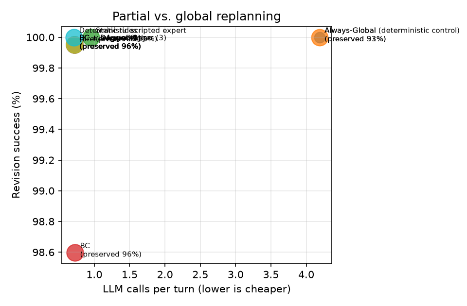
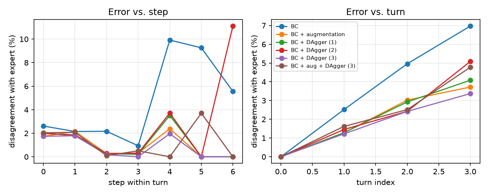

# Results (test split)

Config: `{'seeds': [0, 1, 2], 'split': 'test', 'limit': None, 'skip_recovery': True, 'model_suffix': '', 'call_cap': None, 'llm': 'offline', 'models': 'b256bcc46c15'}`

git `1aaeecd` (uncommitted changes) · fingerprints `{'source': '883e3d07447a', 'prompts': 'f9352f57f9ee', 'tasks': '3753a97fdb1e'}`

Rates are percentages. Learned systems: mean ± std over training seeds. LLM calls/tool calls/est. tokens come from the simulated cost model (see README).

| System | Final pass | Revision success | New constr. sat. | Retention | Legacy unaffected preserved | Slots edited | Unneeded global | LLM calls/turn | Tool calls/turn | Est. tokens/turn |
|---|---|---|---|---|---|---|---|---|---|---|
| Always-Global | 100.0 | 100.0 | 100.0 | 100.0 | 31.3 | 73.1 | 48.5 | 4.19 | 3.00 | 6,056 |
| Always-Global (deterministic control) | 100.0 | 100.0 | 100.0 | 100.0 | 93.1 | 21.2 | 50.7 | 4.19 | 3.00 | 6,056 |
| Static rules | 100.0 | 100.0 | 100.0 | 100.0 | 95.4 | 18.9 | 1.6 | 0.95 | 0.71 | 1,464 |
| BC | 97.5 ± 1.5 | 98.6 ± 0.8 | 98.8 ± 0.7 | 99.9 ± 0.1 | 96.3 ± 0.1 | 18.1 ± 0.2 | 0.0 | 0.73 ± 0.01 | 0.64 ± 0.01 | 1,112 |
| BC + augmentation | 99.9 ± 0.2 | 100.0 ± 0.1 | 100.0 | 100.0 | 96.1 ± 0.0 | 18.6 ± 0.1 | 0.0 | 0.72 ± 0.00 | 0.63 ± 0.00 | 1,106 |
| BC + DAgger (1) | 99.9 ± 0.2 | 100.0 ± 0.1 | 99.9 ± 0.1 | 100.0 | 96.1 ± 0.0 | 18.5 ± 0.0 | 0.0 | 0.72 ± 0.00 | 0.64 ± 0.00 | 1,103 |
| BC + DAgger (2) | 99.9 ± 0.2 | 100.0 ± 0.1 | 100.0 | 100.0 | 96.1 ± 0.0 | 18.6 ± 0.0 | 0.0 | 0.72 ± 0.00 | 0.64 ± 0.00 | 1,108 |
| BC + DAgger (3) | 99.9 ± 0.2 | 100.0 ± 0.1 | 100.0 | 100.0 | 96.1 ± 0.0 | 18.6 ± 0.0 | 0.0 | 0.72 ± 0.00 | 0.63 ± 0.00 | 1,105 |
| BC + aug + DAgger (3) | 99.9 ± 0.2 | 100.0 ± 0.1 | 99.9 ± 0.1 | 100.0 | 96.1 ± 0.0 | 18.6 ± 0.1 | 0.0 | 0.72 ± 0.00 | 0.64 ± 0.00 | 1,112 |
| Deterministic scripted expert | 100.0 | 100.0 | 100.0 | 100.0 | 96.1 | 18.6 | 0.0 | 0.71 | 0.63 | 1,097 |

## Minimum necessary changes

Exact minimum slot edits over complete feasible plans. Scored only on successful feasible turns; read alongside revision success and the scored-turn count. Budget turns include all costed slots. Optimal preservation = 1 − excess edits / (13 − minimum edits); undefined when all 13 must change. The legacy unaffected-slot metric above is retained for comparison.

| System | Scored turns (mean) | Minimum edits | Excess edits | Optimal preservation % |
|---|---|---|---|---|
| Always-Global | 560 | 1.28 | 8.22 | 30.0 |
| Always-Global (deterministic control) | 560 | 1.24 | 1.52 | 86.9 |
| Static rules | 560 | 1.25 | 1.21 | 89.0 |
| BC | 551.667 | 1.23 ± 0.02 | 1.16 ± 0.01 | 89.7 ± 0.1 |
| BC + augmentation | 560 | 1.26 | 1.17 ± 0.01 | 89.6 ± 0.1 |
| BC + DAgger (1) | 559.667 | 1.25 ± 0.00 | 1.16 ± 0.00 | 89.6 ± 0.0 |
| BC + DAgger (2) | 560 | 1.26 | 1.16 ± 0.00 | 89.6 ± 0.0 |
| BC + DAgger (3) | 560 | 1.26 | 1.16 ± 0.00 | 89.6 ± 0.0 |
| BC + aug + DAgger (3) | 559.667 | 1.26 ± 0.00 | 1.16 ± 0.01 | 89.7 ± 0.0 |
| Deterministic scripted expert | 560 | 1.26 | 1.16 | 89.7 |

## Clarification behaviour

| System | Recall on infeasible updates | Precision | Timeouts | Budget exhausted |
|---|---|---|---|---|
| Always-Global | 100.0 | 100.0 | 0.0 | 0.0 |
| Always-Global (deterministic control) | 100.0 | 100.0 | 0.0 | 0.0 |
| Static rules | 100.0 | 100.0 | 0.0 | 0.0 |
| BC | 99.0 ± 1.0 | 95.3 ± 2.8 | 0.2 ± 0.2 | 0.0 |
| BC + augmentation | 99.7 ± 0.4 | 100.0 | 0.0 | 0.0 |
| BC + DAgger (1) | 100.0 | 100.0 | 0.0 | 0.0 |
| BC + DAgger (2) | 99.7 ± 0.4 | 100.0 | 0.0 ± 0.1 | 0.0 |
| BC + DAgger (3) | 99.7 ± 0.4 | 100.0 | 0.0 | 0.0 |
| BC + aug + DAgger (3) | 100.0 | 100.0 | 0.0 ± 0.1 | 0.0 |
| Deterministic scripted expert | 100.0 | 100.0 | 0.0 | 0.0 |

## By update type

Revision success % / unaffected preserved %. Learned systems: training seed 0.

| System | add | delete | replace | reprioritize |
|---|---|---|---|---|
| Always-Global | 100.0 / 33 | 100.0 / 25 | 100.0 / 31 | 100.0 / 21 |
| Always-Global (deterministic control) | 100.0 / 93 | 100.0 / 83 | 100.0 / 98 | 100.0 / 99 |
| Static rules | 100.0 / 94 | 100.0 / 100 | 100.0 / 98 | 100.0 / 100 |
| BC | 97.4 / 95 | 98.0 / 100 | 100.0 / 100 | 97.1 / 100 |
| BC + augmentation | 100.0 / 94 | 100.0 / 100 | 100.0 / 100 | 100.0 / 100 |
| BC + DAgger (1) | 100.0 / 95 | 100.0 / 100 | 100.0 / 100 | 100.0 / 100 |
| BC + DAgger (2) | 99.8 / 95 | 100.0 / 100 | 100.0 / 100 | 100.0 / 100 |
| BC + DAgger (3) | 100.0 / 94 | 100.0 / 100 | 100.0 / 100 | 100.0 / 100 |
| BC + aug + DAgger (3) | 100.0 / 94 | 100.0 / 100 | 100.0 / 100 | 100.0 / 100 |
| Deterministic scripted expert | 100.0 / 95 | 100.0 / 100 | 100.0 / 100 | 100.0 / 100 |

## By turn position (4th turn only exists in test)

Revision success % / unaffected preserved %. Learned systems: training seed 0.

| System | held-out (4th turn) | turn 1 | turn 2 | turn 3 |
|---|---|---|---|---|
| Always-Global | 100.0 / 35 | 100.0 / 31 | 100.0 / 29 | 100.0 / 33 |
| Always-Global (deterministic control) | 100.0 / 89 | 100.0 / 94 | 100.0 / 94 | 100.0 / 93 |
| Static rules | 100.0 / 96 | 100.0 / 95 | 100.0 / 95 | 100.0 / 96 |
| BC | 92.8 / 97 | 100.0 / 96 | 97.6 / 96 | 96.3 / 98 |
| BC + augmentation | 100.0 / 97 | 100.0 / 96 | 100.0 / 96 | 100.0 / 97 |
| BC + DAgger (1) | 100.0 / 97 | 100.0 / 96 | 100.0 / 96 | 100.0 / 97 |
| BC + DAgger (2) | 98.6 / 97 | 100.0 / 96 | 100.0 / 96 | 100.0 / 97 |
| BC + DAgger (3) | 100.0 / 97 | 100.0 / 96 | 100.0 / 96 | 100.0 / 97 |
| BC + aug + DAgger (3) | 100.0 / 97 | 100.0 / 96 | 100.0 / 96 | 100.0 / 97 |
| Deterministic scripted expert | 100.0 / 97 | 100.0 / 96 | 100.0 / 96 | 100.0 / 97 |

## Figures

