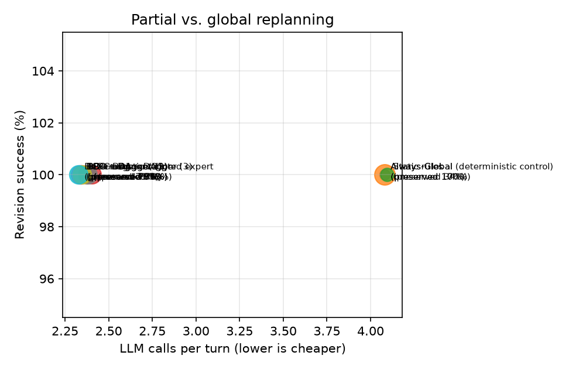
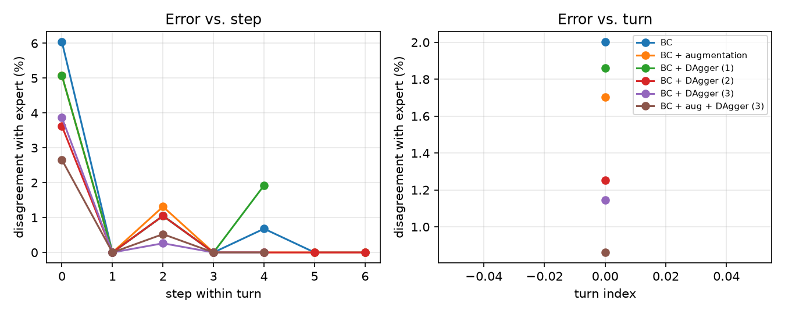

# Results (test_multi split)

Config: `{'seeds': [0, 1, 2], 'split': 'test_multi', 'limit': None, 'skip_recovery': True, 'model_suffix': '', 'call_cap': None, 'llm': 'offline', 'models': 'f7a33da8563c'}`

git `d660d4e` (uncommitted changes) · fingerprints `{'source': 'bc8ce14085cc', 'prompts': 'f9352f57f9ee', 'tasks': '31cf06aeb6b9'}`

Rates are percentages. Learned systems: mean ± std over training seeds. LLM calls/tool calls/est. tokens come from the simulated cost model (see README).

| System | Final pass | Revision success | New constr. sat. | Retention | Legacy unaffected preserved | Slots edited | Unneeded global | LLM calls/turn | Tool calls/turn | Est. tokens/turn |
|---|---|---|---|---|---|---|---|---|---|---|
| Always-Global | 100.0 | 100.0 | 100.0 | 100.0 | 16.5 | 93.3 | 60.9 | 4.08 | 3.00 | 6,024 |
| Always-Global (deterministic control) | 100.0 | 100.0 | 100.0 | 100.0 | 100.0 | 67.9 | 60.9 | 4.08 | 3.00 | 6,024 |
| Static rules | 100.0 | 100.0 | 100.0 | 100.0 | 34.4 | 77.4 | 44.2 | 4.09 | 2.26 | 6,046 |
| BC | 100.0 | 100.0 | 100.0 | 100.0 | 76.4 ± 0.7 | 46.1 ± 0.6 | 3.4 ± 0.3 | 2.40 ± 0.01 | 1.01 ± 0.02 | 3,509 |
| BC + augmentation | 100.0 | 100.0 | 100.0 | 100.0 | 79.3 ± 1.3 | 44.3 ± 0.5 | 1.2 ± 0.9 | 2.34 ± 0.02 | 0.92 ± 0.04 | 3,408 |
| BC + DAgger (1) | 100.0 | 100.0 | 100.0 | 100.0 | 77.5 ± 0.4 | 45.1 ± 0.5 | 2.4 ± 0.3 | 2.38 ± 0.02 | 0.99 ± 0.01 | 3,470 |
| BC + DAgger (2) | 100.0 | 100.0 | 100.0 | 100.0 | 78.5 ± 0.6 | 44.7 ± 0.3 | 1.7 ± 0.3 | 2.34 ± 0.01 | 0.93 ± 0.02 | 3,419 |
| BC + DAgger (3) | 100.0 | 100.0 | 100.0 | 100.0 | 76.4 ± 1.0 | 45.8 ± 0.6 | 2.9 ± 1.0 | 2.38 ± 0.02 | 1.01 ± 0.04 | 3,473 |
| BC + aug + DAgger (3) | 100.0 | 100.0 | 100.0 | 100.0 | 77.8 ± 1.3 | 45.1 ± 0.5 | 1.2 ± 0.7 | 2.35 ± 0.02 | 0.95 ± 0.04 | 3,422 |
| Deterministic scripted expert | 100.0 | 100.0 | 100.0 | 100.0 | 78.5 | 44.3 | 0.0 | 2.33 | 0.93 | 3,393 |

## Minimum necessary changes

Exact minimum slot edits over complete feasible plans. Scored only on successful feasible turns; read alongside revision success and the scored-turn count. Budget turns include all costed slots. Optimal preservation = 1 − excess edits / (13 − minimum edits); undefined when all 13 must change. The legacy unaffected-slot metric above is retained for comparison.

| System | Scored turns (mean) | Minimum edits | Excess edits | Optimal preservation % |
|---|---|---|---|---|
| Always-Global | 127 | 4.12 | 8.01 | 16.0 |
| Always-Global (deterministic control) | 127 | 4.12 | 4.71 | 53.1 |
| Static rules | 127 | 4.12 | 5.94 | 33.2 |
| BC | 127 | 4.12 | 1.87 ± 0.07 | 73.7 ± 0.8 |
| BC + augmentation | 127 | 4.12 | 1.64 ± 0.06 | 76.2 ± 0.8 |
| BC + DAgger (1) | 127 | 4.12 | 1.75 ± 0.06 | 74.8 ± 0.6 |
| BC + DAgger (2) | 127 | 4.12 | 1.70 ± 0.04 | 75.6 ± 0.4 |
| BC + DAgger (3) | 127 | 4.12 | 1.83 ± 0.08 | 74.0 ± 0.8 |
| BC + aug + DAgger (3) | 127 | 4.12 | 1.74 ± 0.06 | 75.0 ± 0.9 |
| Deterministic scripted expert | 127 | 4.12 | 1.64 | 76.1 |

## Clarification behaviour

| System | Recall on infeasible updates | Precision | Timeouts | Budget exhausted |
|---|---|---|---|---|
| Always-Global | 100.0 | 100.0 | 0.0 | 0.0 |
| Always-Global (deterministic control) | 100.0 | 100.0 | 0.0 | 0.0 |
| Static rules | 100.0 | 100.0 | 0.0 | 0.0 |
| BC | 100.0 | 100.0 | 0.0 | 0.0 |
| BC + augmentation | 100.0 | 100.0 | 0.0 | 0.0 |
| BC + DAgger (1) | 100.0 | 100.0 | 0.0 | 0.0 |
| BC + DAgger (2) | 100.0 | 100.0 | 0.0 | 0.0 |
| BC + DAgger (3) | 100.0 | 100.0 | 0.0 | 0.0 |
| BC + aug + DAgger (3) | 100.0 | 100.0 | 0.0 | 0.0 |
| Deterministic scripted expert | 100.0 | 100.0 | 0.0 | 0.0 |

## By update type

Revision success % / unaffected preserved %. Learned systems: training seed 0.

| System | replace |
|---|---|
| Always-Global | 100.0 / 17 |
| Always-Global (deterministic control) | 100.0 / 100 |
| Static rules | 100.0 / 34 |
| BC | 100.0 / 77 |
| BC + augmentation | 100.0 / 78 |
| BC + DAgger (1) | 100.0 / 77 |
| BC + DAgger (2) | 100.0 / 79 |
| BC + DAgger (3) | 100.0 / 78 |
| BC + aug + DAgger (3) | 100.0 / 78 |
| Deterministic scripted expert | 100.0 / 79 |

## By turn position (4th turn only exists in test)

Revision success % / unaffected preserved %. Learned systems: training seed 0.

| System | turn 1 |
|---|---|
| Always-Global | 100.0 / 17 |
| Always-Global (deterministic control) | 100.0 / 100 |
| Static rules | 100.0 / 34 |
| BC | 100.0 / 77 |
| BC + augmentation | 100.0 / 78 |
| BC + DAgger (1) | 100.0 / 77 |
| BC + DAgger (2) | 100.0 / 79 |
| BC + DAgger (3) | 100.0 / 78 |
| BC + aug + DAgger (3) | 100.0 / 78 |
| Deterministic scripted expert | 100.0 / 79 |

## Figures

