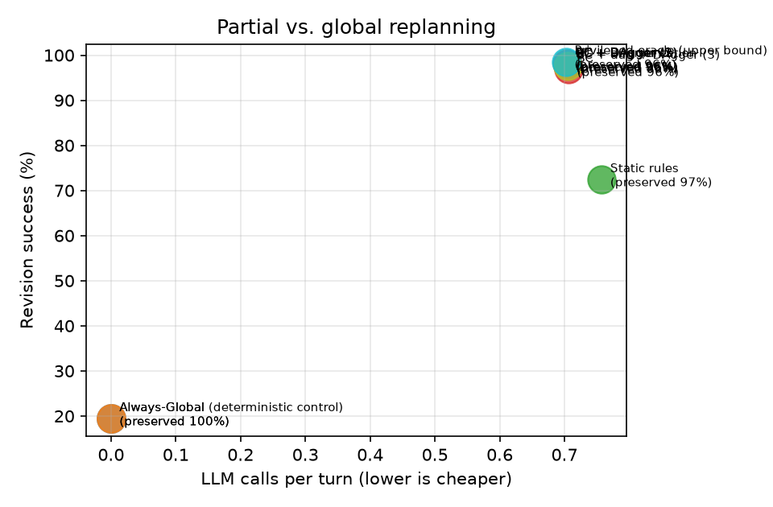
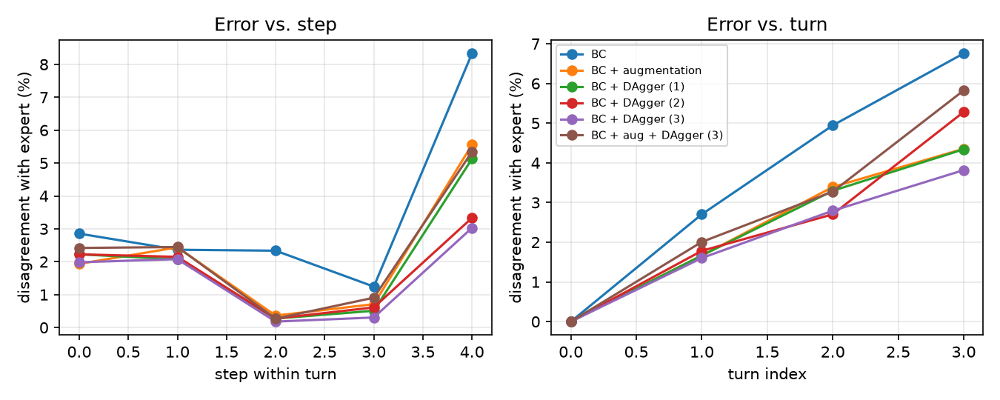
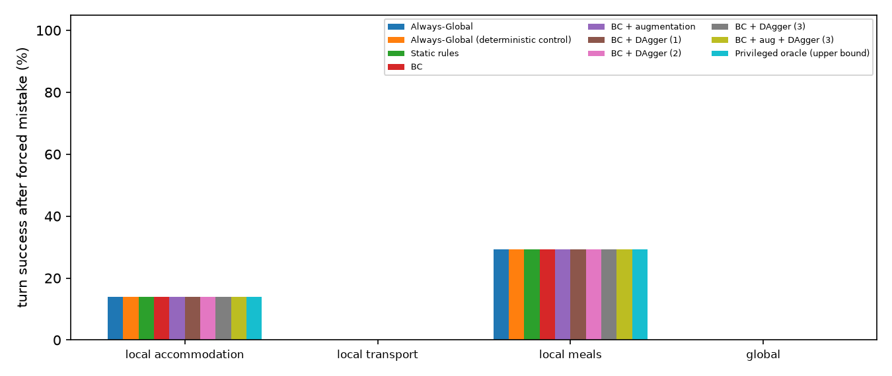

# Results (test split)

Config: `{'seeds': [0, 1, 2], 'split': 'test', 'limit': None, 'skip_recovery': False, 'model_suffix': '', 'call_cap': 1, 'llm': 'offline', 'models': 'b256bcc46c15'}`

git `aa219a4` · fingerprints `{'source': '6ae63bc04fc2', 'prompts': 'f9352f57f9ee', 'tasks': '3753a97fdb1e'}`

Rates are percentages. Learned systems: mean ± std over training seeds. LLM calls/tool calls/est. tokens come from the simulated cost model (see README).

Matched budget: at most 1 cost-model LLM calls per turn; a turn that would exceed it ends as BUDGET_EXHAUSTED with the plan as it is.

| System | Final pass | Revision success | New constr. sat. | Retention | Unaffected preserved | Slots edited | Unneeded global | LLM calls/turn | Tool calls/turn | Est. tokens/turn |
|---|---|---|---|---|---|---|---|---|---|---|
| Always-Global | 17.4 | 19.4 | 35.4 | 83.7 | 100.0 | 0.0 | 0.0 | 0.00 | 0.00 | 0 |
| Always-Global (deterministic control) | 17.4 | 19.4 | 35.4 | 83.7 | 100.0 | 0.0 | 0.0 | 0.00 | 0.00 | 0 |
| Static rules | 65.6 | 72.4 | 98.4 | 94.8 | 96.5 | 18.3 | 0.0 | 0.76 | 0.71 | 1,398 |
| BC | 94.9 ± 1.4 | 96.9 ± 0.7 | 98.8 ± 0.7 | 98.9 ± 0.1 | 96.4 ± 0.1 | 18.1 ± 0.2 | 0.0 | 0.71 ± 0.00 | 0.64 ± 0.00 | 1,085 |
| BC + augmentation | 96.9 ± 0.3 | 98.0 ± 0.2 | 99.9 ± 0.1 | 99.0 | 96.3 ± 0.0 | 18.5 ± 0.1 | 0.0 | 0.71 ± 0.00 | 0.64 ± 0.00 | 1,092 |
| BC + DAgger (1) | 97.1 | 98.1 ± 0.0 | 99.9 ± 0.1 | 99.0 ± 0.0 | 96.3 | 18.4 ± 0.0 | 0.0 | 0.70 | 0.64 ± 0.00 | 1,090 |
| BC + DAgger (2) | 96.9 ± 0.2 | 98.0 ± 0.1 | 99.9 ± 0.1 | 99.0 | 96.3 ± 0.0 | 18.5 ± 0.0 | 0.0 | 0.70 ± 0.00 | 0.64 ± 0.00 | 1,090 |
| BC + DAgger (3) | 96.7 | 98.0 | 100.0 | 99.0 | 96.3 ± 0.0 | 18.5 ± 0.0 | 0.0 | 0.70 ± 0.00 | 0.64 ± 0.00 | 1,090 |
| BC + aug + DAgger (3) | 96.4 ± 0.3 | 97.6 ± 0.2 | 99.9 ± 0.2 | 98.9 ± 0.0 | 96.3 ± 0.0 | 18.5 ± 0.0 | 0.0 | 0.71 ± 0.00 | 0.64 ± 0.00 | 1,096 |
| Privileged oracle (upper bound) | 97.8 | 98.5 | 99.6 | 99.1 | 96.4 | 18.3 | 0.0 | 0.70 | 0.63 | 1,082 |

## Clarification behaviour

| System | Recall on infeasible updates | Precision | Timeouts | Budget exhausted |
|---|---|---|---|---|
| Always-Global | 0.0 | – | 0.0 | 100.0 |
| Always-Global (deterministic control) | 0.0 | – | 0.0 | 100.0 |
| Static rules | 0.0 | 0.0 | 0.0 | 29.5 |
| BC | 97.4 ± 0.4 | 95.5 ± 2.6 | 0.0 | 2.0 ± 0.1 |
| BC + augmentation | 97.9 ± 0.7 | 99.5 ± 0.4 | 0.0 | 1.9 ± 0.1 |
| BC + DAgger (1) | 98.2 ± 0.4 | 99.5 ± 0.4 | 0.0 | 1.7 ± 0.1 |
| BC + DAgger (2) | 98.2 ± 0.4 | 99.5 ± 0.4 | 0.0 | 1.9 ± 0.1 |
| BC + DAgger (3) | 97.7 | 99.2 | 0.0 | 1.8 ± 0.1 |
| BC + aug + DAgger (3) | 96.6 ± 0.4 | 99.5 ± 0.4 | 0.0 | 2.3 ± 0.3 |
| Privileged oracle (upper bound) | 100.0 | 100.0 | 0.0 | 1.5 |

## Recovery from a forced mistake (164 episodes whose first update needs a repair)

The listed action is forced as the first step of the turn; the coordinator then continues. Cell = turn success % over all selected episodes / over the episodes where the forced action left the plan broken (n), then LLM calls. Mistakes that already fix the plan (e.g. a global rebuild) say nothing about recovery.

| System | REPLAN_LOCAL_ACCOMMODATION | REPLAN_LOCAL_TRANSPORT | REPLAN_LOCAL_MEALS | REPLAN_GLOBAL |
|---|---|---|---|---|
| Always-Global | 14.0 / 0.0 (n=141), 1.00 | 0.0 / 0.0 (n=164), 1.00 | 29.3 / 0.0 (n=116), 1.00 | 0.0 / – (n=0), 0.00 |
| Always-Global (deterministic control) | 14.0 / 0.0 (n=141), 1.00 | 0.0 / 0.0 (n=164), 1.00 | 29.3 / 0.0 (n=116), 1.00 | 0.0 / – (n=0), 0.00 |
| Static rules | 14.0 / 0.0 (n=141), 1.00 | 0.0 / 0.0 (n=164), 1.00 | 29.3 / 0.0 (n=116), 1.00 | 0.0 / – (n=0), 0.00 |
| BC | 14.0 / 0.0 (n=141), 1.00 | 0.0 / 0.0 (n=164), 1.00 | 29.3 / 0.0 (n=116), 1.00 | 0.0 / – (n=0), 0.00 |
| BC + augmentation | 14.0 / 0.0 (n=141), 1.00 | 0.0 / 0.0 (n=164), 1.00 | 29.3 / 0.0 (n=116), 1.00 | 0.0 / – (n=0), 0.00 |
| BC + DAgger (1) | 14.0 / 0.0 (n=141), 1.00 | 0.0 / 0.0 (n=164), 1.00 | 29.3 / 0.0 (n=116), 1.00 | 0.0 / – (n=0), 0.00 |
| BC + DAgger (2) | 14.0 / 0.0 (n=141), 1.00 | 0.0 / 0.0 (n=164), 1.00 | 29.3 / 0.0 (n=116), 1.00 | 0.0 / – (n=0), 0.00 |
| BC + DAgger (3) | 14.0 / 0.0 (n=141), 1.00 | 0.0 / 0.0 (n=164), 1.00 | 29.3 / 0.0 (n=116), 1.00 | 0.0 / – (n=0), 0.00 |
| BC + aug + DAgger (3) | 14.0 / 0.0 (n=141), 1.00 | 0.0 / 0.0 (n=164), 1.00 | 29.3 / 0.0 (n=116), 1.00 | 0.0 / – (n=0), 0.00 |
| Privileged oracle (upper bound) | 14.0 / 0.0 (n=141), 1.00 | 0.0 / 0.0 (n=164), 1.00 | 29.3 / 0.0 (n=116), 1.00 | 0.0 / – (n=0), 0.00 |

## By update type

Revision success % / unaffected preserved %. Learned systems: training seed 0.

| System | add | delete | replace | reprioritize |
|---|---|---|---|---|
| Always-Global | 15.0 / 100 | 67.3 / 100 | 7.8 / 100 | 32.9 / 100 |
| Always-Global (deterministic control) | 15.0 / 100 | 67.3 / 100 | 7.8 / 100 | 32.9 / 100 |
| Static rules | 76.7 / 95 | 75.5 / 100 | 58.8 / 100 | 61.4 / 100 |
| BC | 95.5 / 95 | 98.0 / 100 | 99.0 / 100 | 97.1 / 100 |
| BC + augmentation | 97.4 / 95 | 98.0 / 100 | 100.0 / 100 | 100.0 / 100 |
| BC + DAgger (1) | 97.4 / 95 | 100.0 / 100 | 99.0 / 100 | 100.0 / 100 |
| BC + DAgger (2) | 97.4 / 95 | 98.0 / 100 | 99.0 / 100 | 100.0 / 100 |
| BC + DAgger (3) | 97.4 / 95 | 98.0 / 100 | 99.0 / 100 | 100.0 / 100 |
| BC + aug + DAgger (3) | 97.2 / 95 | 98.0 / 100 | 99.0 / 100 | 100.0 / 100 |
| Privileged oracle (upper bound) | 97.9 / 95 | 100.0 / 100 | 100.0 / 100 | 100.0 / 100 |

## By turn position (4th turn only exists in test)

Revision success % / unaffected preserved %. Learned systems: training seed 0.

| System | held-out (4th turn) | turn 1 | turn 2 | turn 3 |
|---|---|---|---|---|
| Always-Global | 14.5 / 100 | 23.9 / 100 | 18.1 / 100 | 14.9 / 100 |
| Always-Global (deterministic control) | 14.5 / 100 | 23.9 / 100 | 18.1 / 100 | 14.9 / 100 |
| Static rules | 52.2 / 98 | 83.0 / 96 | 72.4 / 96 | 61.2 / 98 |
| BC | 89.9 / 98 | 99.6 / 96 | 94.8 / 96 | 95.5 / 98 |
| BC + augmentation | 94.2 / 97 | 99.6 / 96 | 96.7 / 96 | 99.3 / 97 |
| BC + DAgger (1) | 95.7 / 97 | 99.6 / 96 | 96.7 / 96 | 98.5 / 97 |
| BC + DAgger (2) | 92.8 / 97 | 99.6 / 96 | 96.7 / 96 | 99.3 / 97 |
| BC + DAgger (3) | 94.2 / 97 | 99.6 / 96 | 96.2 / 96 | 99.3 / 97 |
| BC + aug + DAgger (3) | 94.2 / 97 | 99.6 / 96 | 96.2 / 96 | 98.5 / 97 |
| Privileged oracle (upper bound) | 97.1 / 98 | 99.6 / 96 | 97.1 / 96 | 99.3 / 97 |

## Figures

