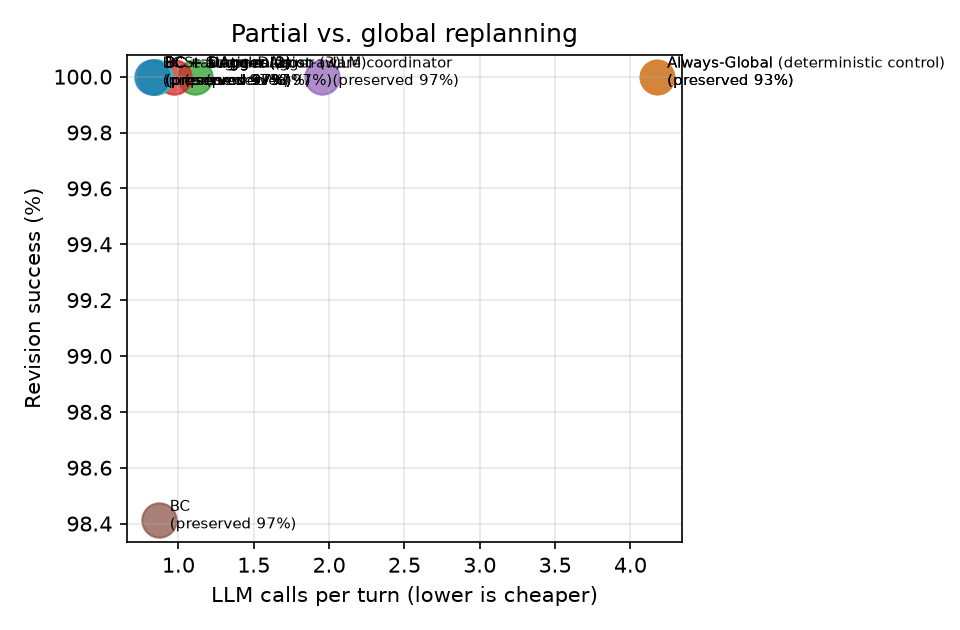
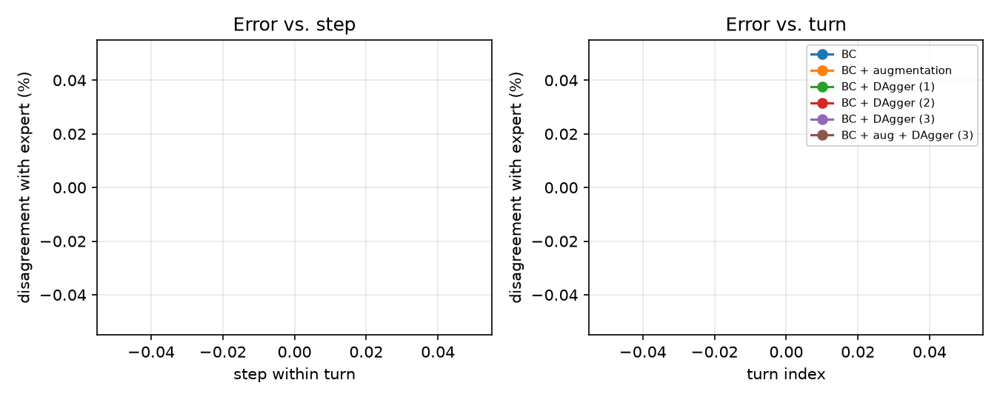

# Results (val split)

Config: `{'seeds': [0], 'split': 'val', 'limit': 30, 'skip_recovery': True, 'model_suffix': '', 'call_cap': None, 'llm': {'provider': 'fake', 'model': 'fake', 'endpoint': 'local://fake', 'temperature': 0.0}, 'models': 'a6b241c28a2f'}`

git `025b2bb` · fingerprints `{'source': 'bc8ce14085cc', 'prompts': 'f9352f57f9ee', 'tasks': '31cf06aeb6b9'}`

Rates are percentages. Learned systems: mean ± std over training seeds. LLM calls/tool calls/est. tokens come from the simulated cost model (see README); measured columns come from the live client.

| System | Final pass | Revision success | New constr. sat. | Retention | Legacy unaffected preserved | Slots edited | Unneeded global | LLM calls/turn | Tool calls/turn | Est. tokens/turn | Measured LLM requests/turn | Measured tokens/turn |
|---|---|---|---|---|---|---|---|---|---|---|---|---|
| Always-Global | 100.0 | 100.0 | 100.0 | 100.0 | 92.6 | 28.4 | – | 4.17 | 3.00 | 6,052 | 4.98 | 1,173 |
| Always-Global (deterministic control) | 100.0 | 100.0 | 100.0 | 100.0 | 92.6 | 28.4 | – | 4.17 | 3.00 | 6,052 | 4.98 | 1,173 |
| Static rules | 100.0 | 100.0 | 100.0 | 100.0 | 96.9 | 24.4 | – | 1.11 | 0.89 | 1,775 | 1.92 | 460 |
| LLM coordinator | 100.0 | 100.0 | 100.0 | 100.0 | 96.9 | 24.4 | – | 1.95 | 1.29 | 3,005 | 6.86 | 1,966 |
| BC | 96.7 | 98.4 | 100.0 | 100.0 | 96.9 | 24.4 | – | 0.83 | 0.73 | 1,340 | 1.67 | 410 |
| BC + augmentation | 100.0 | 100.0 | 100.0 | 100.0 | 96.9 | 24.4 | – | 0.84 | 0.75 | 1,351 | 1.67 | 410 |
| BC + DAgger (1) | 100.0 | 100.0 | 100.0 | 100.0 | 96.9 | 24.4 | – | 0.84 | 0.75 | 1,351 | 1.67 | 410 |
| BC + DAgger (2) | 100.0 | 100.0 | 100.0 | 100.0 | 96.9 | 24.4 | – | 0.84 | 0.75 | 1,351 | 1.67 | 410 |
| BC + DAgger (3) | 100.0 | 100.0 | 100.0 | 100.0 | 96.9 | 24.4 | – | 0.84 | 0.76 | 1,357 | 1.67 | 410 |
| BC + aug + DAgger (3) | 100.0 | 100.0 | 100.0 | 100.0 | 96.9 | 24.4 | – | 0.86 | 0.76 | 1,381 | 1.68 | 414 |

## Minimum necessary changes

Exact minimum slot edits over complete feasible plans. Scored only on successful feasible turns; read alongside revision success and the scored-turn count. Budget turns include all costed slots. Optimal preservation = 1 − excess edits / (13 − minimum edits); undefined when all 13 must change. The legacy unaffected-slot metric above is retained for comparison.

| System | Scored turns (mean) | Minimum edits | Excess edits | Optimal preservation % |
|---|---|---|---|---|
| Always-Global | 52 | 1.48 | 2.21 | 81.3 |
| Always-Global (deterministic control) | 52 | 1.48 | 2.21 | 81.3 |
| Static rules | 52 | 1.50 | 1.67 | 85.4 |
| LLM coordinator | 52 | 1.50 | 1.67 | 85.4 |
| BC | 52 | 1.50 | 1.67 | 85.4 |
| BC + augmentation | 52 | 1.50 | 1.67 | 85.4 |
| BC + DAgger (1) | 52 | 1.50 | 1.67 | 85.4 |
| BC + DAgger (2) | 52 | 1.50 | 1.67 | 85.4 |
| BC + DAgger (3) | 52 | 1.50 | 1.67 | 85.4 |
| BC + aug + DAgger (3) | 52 | 1.50 | 1.67 | 85.4 |

The scripted expert and expert-disagreement labels are disabled for LLM transitions. An LLM teacher is a fallible demonstrator, not an optimality oracle.

## Clarification behaviour

| System | Recall on infeasible updates | Precision | Timeouts | Budget exhausted |
|---|---|---|---|---|
| Always-Global | 100.0 | 100.0 | 0.0 | 0.0 |
| Always-Global (deterministic control) | 100.0 | 100.0 | 0.0 | 0.0 |
| Static rules | 100.0 | 100.0 | 0.0 | 0.0 |
| LLM coordinator | 100.0 | 100.0 | 0.0 | 0.0 |
| BC | 90.9 | 100.0 | 0.0 | 0.0 |
| BC + augmentation | 100.0 | 100.0 | 0.0 | 0.0 |
| BC + DAgger (1) | 100.0 | 100.0 | 0.0 | 0.0 |
| BC + DAgger (2) | 100.0 | 100.0 | 0.0 | 0.0 |
| BC + DAgger (3) | 100.0 | 100.0 | 0.0 | 0.0 |
| BC + aug + DAgger (3) | 100.0 | 100.0 | 0.0 | 0.0 |

## LLM usage per system (first seed for learned systems)

| System | Requests | Billed calls | Cache hits | Errors | Fallbacks | Fallback rate | Degraded |
|---|---|---|---|---|---|---|---|
| Always-Global | 314 | 0 | 314 | 0 | 0 | 0.0% | no |
| Always-Global (deterministic control) | 314 | 0 | 314 | 0 | 0 | 0.0% | no |
| Static rules | 121 | 0 | 121 | 0 | 0 | 0.0% | no |
| LLM coordinator | 432 | 0 | 432 | 0 | 0 | 0.0% | no |
| BC | 105 | 0 | 105 | 0 | 0 | 0.0% | no |
| BC + augmentation | 105 | 0 | 105 | 0 | 0 | 0.0% | no |
| BC + DAgger (1) | 105 | 0 | 105 | 0 | 0 | 0.0% | no |
| BC + DAgger (2) | 105 | 0 | 105 | 0 | 0 | 0.0% | no |
| BC + DAgger (3) | 105 | 0 | 105 | 0 | 0 | 0.0% | no |
| BC + aug + DAgger (3) | 106 | 0 | 106 | 0 | 0 | 0.0% | no |

## By update type

Revision success % / unaffected preserved %. Learned systems: training seed 0.

| System | add | delete | replace | reprioritize |
|---|---|---|---|---|
| Always-Global | 100.0 / 92 | 100.0 / 69 | 100.0 / 100 | 100.0 / 100 |
| Always-Global (deterministic control) | 100.0 / 92 | 100.0 / 69 | 100.0 / 100 | 100.0 / 100 |
| Static rules | 100.0 / 96 | 100.0 / 100 | 100.0 / 100 | 100.0 / 100 |
| LLM coordinator | 100.0 / 96 | 100.0 / 100 | 100.0 / 100 | 100.0 / 100 |
| BC | 97.8 / 96 | 100.0 / 100 | 100.0 / 100 | 100.0 / 100 |
| BC + augmentation | 100.0 / 96 | 100.0 / 100 | 100.0 / 100 | 100.0 / 100 |
| BC + DAgger (1) | 100.0 / 96 | 100.0 / 100 | 100.0 / 100 | 100.0 / 100 |
| BC + DAgger (2) | 100.0 / 96 | 100.0 / 100 | 100.0 / 100 | 100.0 / 100 |
| BC + DAgger (3) | 100.0 / 96 | 100.0 / 100 | 100.0 / 100 | 100.0 / 100 |
| BC + aug + DAgger (3) | 100.0 / 96 | 100.0 / 100 | 100.0 / 100 | 100.0 / 100 |

## By turn position (4th turn only exists in test)

Revision success % / unaffected preserved %. Learned systems: training seed 0.

| System | turn 1 | turn 2 | turn 3 |
|---|---|---|---|
| Always-Global | 100.0 / 94 | 100.0 / 90 | 100.0 / 91 |
| Always-Global (deterministic control) | 100.0 / 94 | 100.0 / 90 | 100.0 / 91 |
| Static rules | 100.0 / 98 | 100.0 / 97 | 100.0 / 94 |
| LLM coordinator | 100.0 / 98 | 100.0 / 97 | 100.0 / 94 |
| BC | 100.0 / 98 | 100.0 / 97 | 91.7 / 94 |
| BC + augmentation | 100.0 / 98 | 100.0 / 97 | 100.0 / 94 |
| BC + DAgger (1) | 100.0 / 98 | 100.0 / 97 | 100.0 / 94 |
| BC + DAgger (2) | 100.0 / 98 | 100.0 / 97 | 100.0 / 94 |
| BC + DAgger (3) | 100.0 / 98 | 100.0 / 97 | 100.0 / 94 |
| BC + aug + DAgger (3) | 100.0 / 98 | 100.0 / 97 | 100.0 / 94 |

## Figures

